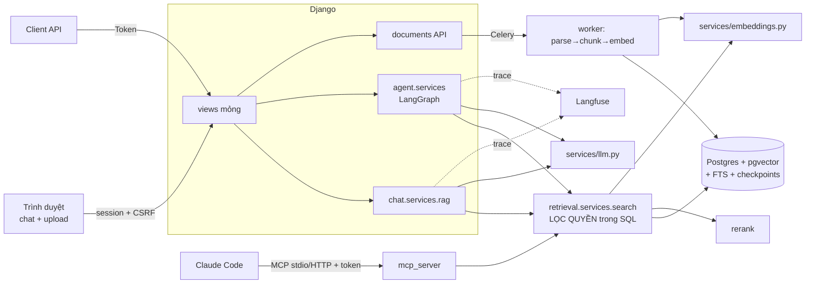

# Kiến trúc

## Quyết định chính
- **Một cổng truy vấn**: `retrieval.services.search(user, q, k)`; UI, agent, MCP đều qua đây nên quyền phòng ban
  (`documents.services.access.visible_documents`) áp dụng một chỗ, ngay trong SQL trước khi xếp hạng.
- **Hybrid**: vector (cosine, HNSW) + Postgres FTS (OR-query, `ts_rank_cd`) → RRF → rerank top 30.
- **Agent** (`agent/services/graph.py`): `agent → tools → agent … → guard → END`. Tool hành động dùng
  `interrupt()`; `create_ticket` chỉ chạy trong `execute_action` sau khi `POST /api/actions/{id}/approve`.
  Giới hạn 6 bước/lượt, checkpoint Postgres theo `session_id`, `guard` từ chối câu trả lời không có bằng chứng.
- **Provider thay được**: `services/llm.py`, `embeddings.py`, `rerank.py`. Thiếu khóa API => bản giả (dev/test offline).
- **Tracing**: `services/tracing.py` — callback tự viết (SDK Langfuse 2.x không tương thích langchain 1.x),
  log JSON mỗi request + đẩy lên Langfuse.
